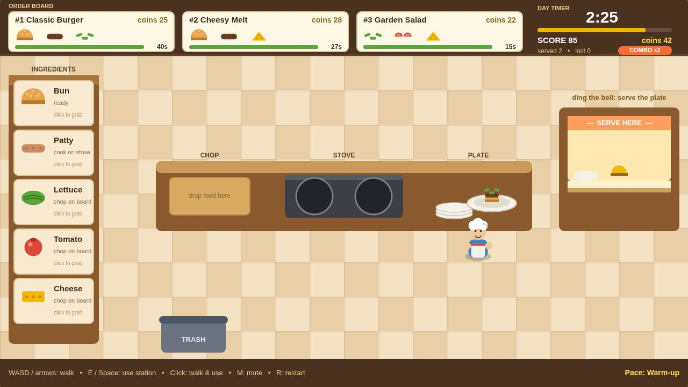
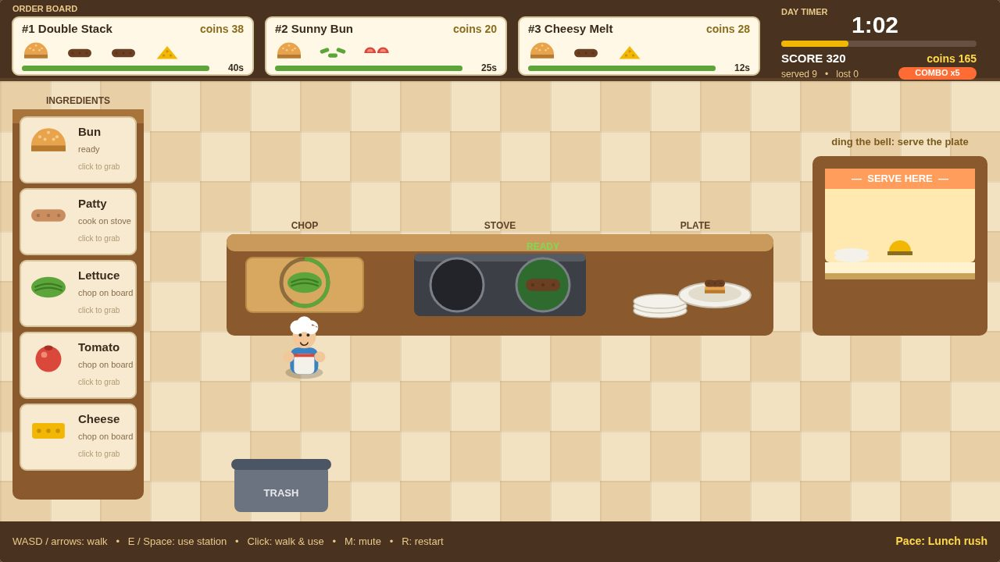
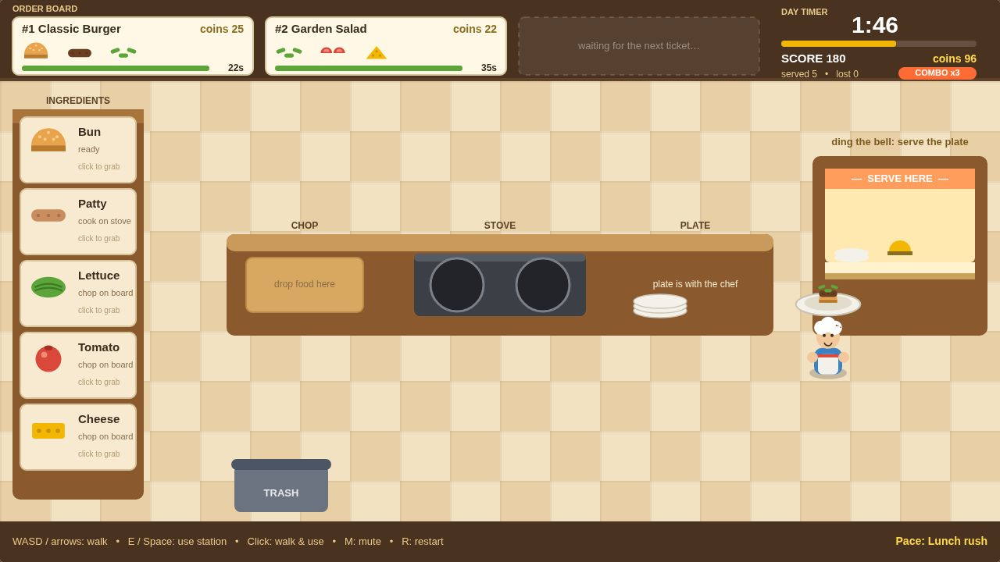

# Sizzle & Serve

[](https://make.fun/bounty/best-cooking-game-20261125-0137?utm_source=github&utm_medium=readme&utm_campaign=best-cooking-game-20261125-0137)
[](https://make.fun/bounty/best-cooking-game-20261125-0137/leaderboard?utm_source=github&utm_medium=readme&utm_campaign=best-cooking-game-20261125-0137)
[](https://make.fun/bounty/best-cooking-game-20261125-0137?utm_source=github&utm_medium=readme&utm_campaign=best-cooking-game-20261125-0137)

Sizzle & Serve — a tiny kitchen rush: tickets roll in on the order board, and you cook them before they walk out. Grab ingredients from the left counter, chop greens on the board, fry patties on the stove (don't let them burn!), stack the dish on a plate, and carry it to the serve window before the ticket's timer runs out. Faster serves pay more, combos stack, and the rush only gets busier across a 3-minute service.

A complete, original, offline browser game: plain ES modules and one 2D canvas, all art drawn in code, synthesized sound effects, no libraries, no network requests.

## Run it

```sh
node serve.ts
```

Then open http://localhost:8080 in a desktop browser. No build step, no network: the game is static files under `game/`, played with keyboard (WASD/arrows to walk, E/Space to use a station, M to mute, R to restart) or mouse (click a station to walk there and use it, click the floor to walk).

## How it plays

- **Goal:** serve as many tickets as you can in one 3-minute service. A ticket expires and the customer walks out if its timer hits zero.
- **Recipes:** Classic Burger, Cheesy Melt, Garden Salad, Double Stack and Sunny Bun — each a different mix of bun, cooked patty, chopped lettuce, tomato and cheese.
- **Prep:** lettuce, tomato and cheese must be chopped on the board; patties must be fried on a burner and go from raw to cooked to burnt if you leave them.
- **Scoring:** each serve pays the ticket's coins plus a time bonus, with +2 per combo step. Serving the wrong plate earns nothing — read the ticket.
- **Pressure:** new tickets arrive faster as the service goes on, from one every ~13s down to one every ~7s, with at most three on the board at once.
- **Screens:** title, play with order board / day timer / score / combo, and a service-over summary with stats and restart.

## Layout

- `game/` — the playable game as static files (`index.html` + `src/*.js`, plain ES modules, no libraries, no network requests)
- `game/src/config.js` — all tuning numbers, station layout, ingredients and recipes
- `game/src/random.js` — seeded RNG so screenshot scenes replay exactly
- `game/src/audio.js` — synthesized WebAudio sound effects, no audio files
- `game/src/world.js` — the simulation: orders, chopping, cooking, plating, serving, scoring
- `game/src/input.js` — keyboard and mouse input
- `game/src/render.js` — all procedural art on one 2D canvas: kitchen, order board, chef, food
- `game/src/shots.js` — deterministic screenshot scenes (`?shot=cover|rush|serve`) that play the real rules with a scripted pilot
- `game/src/main.js` — bootstrap and game loop
- `screenshots/` — three real renders of the game in a browser (cover, dinner rush, plate ready to serve)
- `main.ts` — the hand-in program: copies `game/` and `screenshots/` to `/output` and writes `dossier.json`
- `vendor/makefun-game.ts` — the kit's library, copied unchanged

## Screenshots




